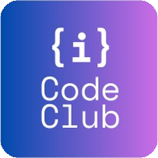

  

## Olá, eu sou Ana Célia! 👋

💻 Cursando **Engenharia de Software** no [Inteli](https://www.inteli.edu.br/).

🎓 Técnica em **Informática** pela Fundação Matias Machline.

🏊‍♀️ Adoro nadar e assistir a séries.

### ✧ Minha jornada

Meu primeiro contato com programação foi aos **10 anos**, com Scratch. Desde então, busco aplicar a tecnologia no dia a dia para criar soluções para problemas reais.

Tenho afinidade com **desenvolvimento front-end e UX design** e interesse em combinar desenvolvimento web, inteligência artificial e blockchain.

### ✧ Minhas stacks

<table>
  <tr>
    <td><strong>Linguagens:</strong></td>
    <td>
      
      
      
      
      
    </td>
  </tr>
  <tr>
    <td><strong>Backend:</strong></td>
    <td>
      
      
    </td>
  </tr>
  <tr>
    <td><strong>Front-end:</strong></td>
    <td>
      
      
      
      
    </td>
  </tr>
  <tr>
    <td><strong>Banco de dados:</strong></td>
    <td>
      
      
      
    </td>
  </tr>
  
  <tr>
    <td><strong>IDEs:</strong></td>
    <td>
      
      
    </td>
  </tr>
</table>

#### ✧ Outras ferramentas

  
  
  
  
  
   
  
  
  

### ✧ Comunidades das quais faço parte

<table width="100%">
  <tr>
    <td align="center" valign="top" width="25%">
       
      <strong>Code Club Inteli</strong>
    </td>
    <td align="center" valign="top" width="25%">
       
      <strong>Inteli Blockchain</strong>
    </td>
    <td align="center" valign="top" width="25%">
       
      <strong>Inteli Júnior</strong>
    </td>
    <td align="center" valign="top" width="25%">
       
      <strong>AgroTech Inteli</strong>
    </td>
  </tr>
</table>

### ✧ Entre em contato!

